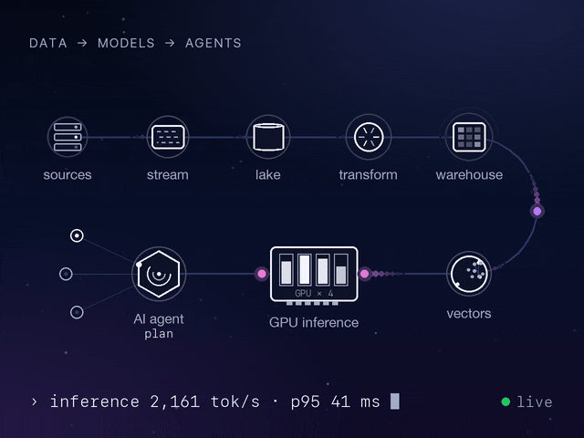

  
  

 

##  About me

<table>
  <tr>
    <td width="58%" valign="top">

Cloud Engineer with **4+ years** across cloud support, databases, data warehousing, analytics, and BI. I like taking messy production workloads and making them reliable, observable, and easy to reason about.

- **Now:** Implementation Engineer at **Protex AI**, deploying computer‑vision safety systems and troubleshooting Linux and networking in the field.
- **Before:** Cloud Support Engineer at **AWS**, on Redshift, QuickSight, Neptune and DataZone: deep dives and performance tuning for pipelines and warehouses.
- **Next:** AI infrastructure, data engineering, and agentic workflows.

</td>
    <td width="42%" align="center" valign="middle">
      
    </td>
  </tr>
</table>

##  Tech stack

**Languages** 

**Cloud & data (AWS first)** 

**Infrastructure, observability & DevOps** 

**Analytics, BI & tools** 

**AI dev tools** 

##  What I work on

<b>Now: Protex AI</b> · Implementation Engineer

 

- Deploying and supporting computer‑vision safety systems at customer sites: cameras, edge devices, and cloud configuration.
- Working with customer network and security teams on IP addressing, VLANs, VPNs, and firewall rules so edge devices reliably reach Protex services and EHS/BI integrations.
- Troubleshooting Linux‑based edge devices and networking issues with logs, metrics, and structured root‑cause analysis.
- Tracking rollouts and writing runbooks in Jira and Confluence, working with product and engineering on smooth go‑lives.

<b>Before: AWS</b> · Cloud Support Engineer

 

- Supported customer **analytics workloads on AWS**: Redshift, Snowflake, DataZone, RDS and related services.
- Used **AWS CloudFormation** (JSON/YAML) to define and deploy Redshift clusters, VPC networking, and security groups as reusable templates across accounts.
- Handled production incidents for data and analytics stacks: performance tuning, systematic troubleshooting, and long‑term fixes with service teams.

##  Certifications & awards

| AWS certifications | AWS Support awards |
| :-- | :-- |
| [Solutions Architect – Associate](https://www.credly.com/badges/fadf5281-c85f-4e35-ba4b-a30b808920d3/public_url) | [All‑Rounder Award](https://www.credly.com/badges/410d2ec2-0e23-4f7c-9ad8-fa42bd2501cb/public_url) |
| [Cloud Practitioner](https://www.credly.com/badges/c452e8db-2eae-45a7-88bf-9eb8b1e85d6f/public_url) | [Wise Guru Award](https://www.credly.com/badges/623f6388-9c75-4d42-b338-22b3e66e68ab/public_url) |
| [AI Practitioner](https://www.credly.com/badges/04c1fa91-e96a-4ebe-9152-1f4a6a4721a0/public_url) | Most Valuable Player, twice ([1](https://www.credly.com/badges/fb1322a2-d7c8-4eb8-85f7-db71017354b1/public_url), [2](https://www.credly.com/badges/14724238-846d-4607-b4ac-2480ad040ea4/public_url)) |

##  GitHub activity

  
  

  

  <picture>
    <source media="(prefers-color-scheme: dark)" srcset="https://raw.githubusercontent.com/daxton-moras/daxton-moras/output/snake-dark.svg" />
    <source media="(prefers-color-scheme: light)" srcset="https://raw.githubusercontent.com/daxton-moras/daxton-moras/output/snake-light.svg" />
    
  </picture>

More at <a href="https://daxton-portfolio-iota.vercel.app">daxton-portfolio-iota.vercel.app</a>

